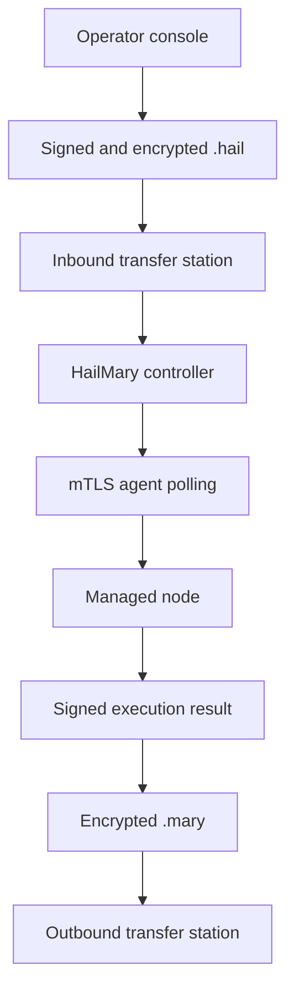

# HailMary

HailMary is an offline-first remote systems management platform for authorized administration of air-gapped networks. Commands cross the boundary as encrypted, signed `.hail` bundles. Results return as encrypted, signed `.mary` bundles. No external machine opens a session to an internal node.

HailMary provides:

- Multi-recipient `.hail` and `.mary` containers using AES-256-GCM
- P-256 ECDSA signatures and P-256 ECDH/HKDF key agreement
- Argon2id-encrypted operator and controller private keys
- Offline trust stores, key fingerprints, revocation state and role restrictions
- One- or two-person approval thresholds based on task risk
- Per-sender monotonic replay protection, expiration and not-before controls
- A controller and outbound-polling agents connected using TLS 1.3 mutual authentication
- Crash-safe agent execution journals that refuse to blindly replay uncertain mutations
- Tamper-evident controller audit logs
- Typed, locally allowlisted actions with no remote shell
- Atomic configuration deployment and automatic rollback after validation failure
- Linux, macOS and Windows release builds

## Trust boundaries

The USB drive is only a carrier. A recommended deployment uses separate inbound and outbound media pools and hardened transfer stations. The internet-facing workstation must never share removable media directly with protected endpoints.



## Supported actions

| Action | Risk | Purpose |
|---|---|---|
| `inventory.collect` | Read-only | OS, hardware, memory and disk inventory |
| `health.collect` | Read-only | Uptime, load, memory, process and disk health |
| `logs.collect` | Read-only | Bounded, redacted reads from named log sources |
| `integrity.verify` | Read-only | Compare files below a named root with SHA-256 manifests |
| `service.status` | Read-only | Inspect an allowlisted service |
| `config.audit` | Read-only | Hash and size an allowlisted configuration target |
| `file.retrieve` | Read-only | Return an allowlisted file inside `.mary` |
| `service.restart` | Reversible | Restart an allowlisted service |
| `config.apply` | Reversible | Atomic deployment, validation and rollback |
| `file.deploy` | Reversible | Atomic deployment to a named local target |
| `package.install` | Disruptive | Run a local installer profile over a signed artifact |
| `patch.apply` | Disruptive | Run a locally defined patch profile |
| `backup.create` | Reversible | Create a bounded tar/gzip backup artifact |
| `system.reboot` | Critical | Run the locally configured reboot profile |

Run `hailmary actions` to obtain the machine-readable registry. Parameters are documented in [docs/TASKS.md](docs/TASKS.md).

## Build

Rust 1.85 or newer is required.

```bash
cargo build --release --locked
cargo test --all-targets --locked
```

The binary is written to `target/release/hailmary` (`hailmary.exe` on Windows).

## Minimal setup

Create password files with restrictive permissions. Passwords are read from files so they do not appear in shell history or process arguments.

```bash
hailmary identity generate \
  --id operator-alice \
  --output state/operator-alice \
  --password-file secrets/operator-alice.password

hailmary identity generate \
  --id secure-controller-1 \
  --output state/controller \
  --password-file secrets/controller.password

hailmary trust init --store state/controller-trust.json
hailmary trust add \
  --store state/controller-trust.json \
  --public state/operator-alice/identity.hmpub \
  --role operator \
  --action '*' \
  --max-risk critical
```

Generate a private TLS CA, controller certificate and agent certificates:

```bash
scripts/generate-pki.sh state/pki controller.internal node-001
hailmary certificate fingerprint --certificate state/pki/agents/node-001.crt
```

Copy [examples/controller.toml](examples/controller.toml), [examples/agent.toml](examples/agent.toml) and [examples/policy.toml](examples/policy.toml), replace their enrollment values, then initialize both sides:

```bash
hailmary controller init --config controller.toml
hailmary agent check --config agent.toml
```

Create an inventory job. The operator sequence is allocated atomically from the identity directory unless `--sequence` is explicitly supplied for controlled recovery.

```bash
hailmary job create \
  --identity state/operator-alice \
  --password-file secrets/operator-alice.password \
  --recipient state/controller/identity.hmpub \
  --action inventory.collect \
  --target node-001 \
  --output transfer/HM-inventory.hail
```

After the `.hail` crosses the approved ingress process:

```bash
hailmary controller import --config controller.toml --input transfer/HM-inventory.hail
hailmary controller serve --config controller.toml
hailmary agent run --config agent.toml
```

When all targets finish:

```bash
hailmary controller export \
  --config controller.toml \
  --job-id JOB_ID \
  --output transfer/HM-inventory.mary

hailmary bundle inspect \
  --input transfer/HM-inventory.mary \
  --identity state/operator-alice \
  --password-file secrets/operator-alice.password \
  --trust state/operator-trust.json
```

See [docs/OPERATIONS.md](docs/OPERATIONS.md) for two-person approval, USB custody and service deployment.

## Security status

HailMary avoids arbitrary remote execution and is built around deny-by-default local policy. It has automated security, tamper, replay, rollback and orchestration tests. Before use in a safety-critical, classified or regulated environment, commission an independent cryptographic review and threat-model assessment for the exact cross-domain deployment.

Security reports are handled according to [SECURITY.md](SECURITY.md).
