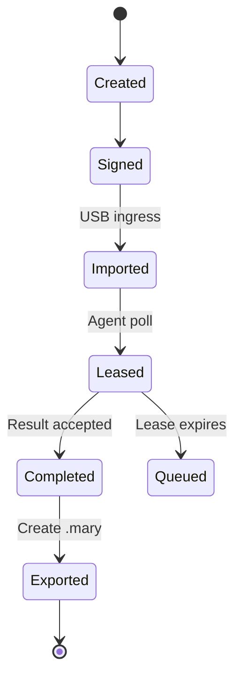

# Architecture

## Components

### Operator console

The console creates identities, manages a local trust store, allocates monotonic sender sequences and produces `.hail` files. It decrypts `.mary` files after they return through the egress process.

### Transfer stations

Transfer stations are deployment controls, not HailMary agents. An ingress station accepts only approved `.hail` objects. An egress station accepts only approved `.mary` objects. The two directions should use different media pools and different operating-system instances.

### Controller

The controller is the only HailMary component that consumes ingress bundles inside the protected network. It verifies the signature threshold and sender permissions before decrypting a job. Accepted jobs enter a SQLite-backed queue and append to a hash-chained audit log.

### Agents

Agents initiate outbound connections to the controller over the internal protected network. TLS 1.3 mutual authentication identifies the node, and the configured certificate fingerprint must match the node enrollment. There is no listening agent port.

Each agent has a local policy describing permitted actions, named paths, services and fixed command profiles. Jobs never contain executable command strings.

## Job lifecycle

If an agent restarts after recording that a task began but before recording its result, it emits `uncertain` instead of automatically replaying the operation. This favors safety over availability for mutations whose outcome cannot be proven.

## Storage

- Operator sender sequences: `operator-state.db` inside the identity directory
- Controller jobs, results, replay state, exports and audit chain: controller SQLite database
- Agent execution journal: one SQLite database per node
- Private keys: encrypted `.hmk` files
- Public identities: `.hmpub` files

SQLite uses WAL mode and a busy timeout. The controller opens short-lived database connections so worker threads do not share connection state.

## Failure model

- Duplicate `.hail`: rejected by bundle ID, job ID and sender sequence
- Duplicate result: accepted only when byte-equivalent to the existing result
- Lost agent response: lease expires and the job can be reclaimed; the agent journal prevents a completed action from executing again
- Lost `.mary`: exporting again returns the original stored bundle rather than generating a different result
- Validator failure: configuration content is restored atomically and the node result records rollback
- Expired job: cannot be imported or claimed
